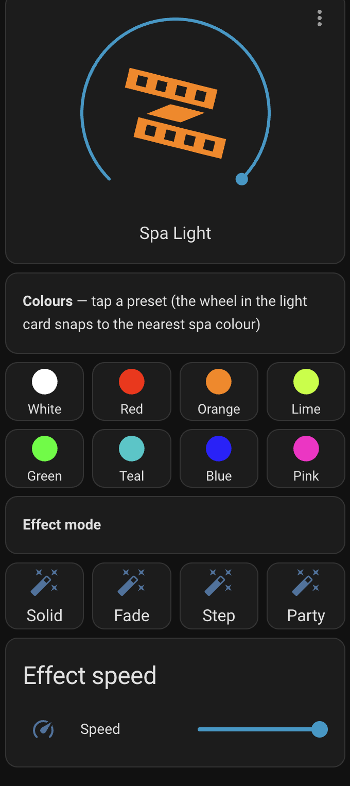

# hass-spanet - supports new SpaNET v2 protocol

Control your SpaNET Spa with Home Assistant

 
 

### Current Progress

 - [x] Sensors
 - [x] HVAC Control
 - [x] Pumps
 - [x] Blower (fan — variable speed & ramp)
 - [x] Operation Mode
 - [x] Power Save
 - [x] Sleep Timers
 - [x] HeatPump Support (Enable via Configure screen)
 - [x] Lights — brightness, colour & effects
 - [x] Sanitise / clean cycle
 - [x] Filtration (runtime, interval & status)
 - [x] Keypad lock
 - [x] Auto-sanitise time
 - [x] Pump timeout

### Tested with Home Assistant 2026.7

# configuration

Simply add the plugin and then provide your SpaNET email and password, all Spas on your account will accessible.

## Pump configuration (V2 development preview)

Existing SpaNET installations need **no pump setup or migration**. On upgrade,
the integration reads each pump's reported speed capability from the SpaNET API.
Home Assistant's original pump switch name, entity ID, and On/Off command
format remain unchanged; detected controllable two-speed pumps also expose a
separate **Pump N Mode** selector and a read-only pump-mode sensor.

To change the default for an individual pump, open **Settings → Devices &
Services → SpaNET → Configure**. The original **Enable Heat Pump** option
remains available. A separate control preference is shown for every detected
pump, including when one account has multiple spas or multiple pumps:

- **Automatic detection (recommended):** A verified single-speed pump uses
  its existing on/off controls; a verified two-speed pump also gets an
  Off / Auto / Low / High selector (Auto appears only when supported).
- **Standard On/Off switch only:** Suppresses the additional mode selector.
  The existing switch is not replaced or renamed. On an API-controllable
  single-speed pump which previously exposed only a sensor, this explicit
  override can add a switch without removing its existing sensor.
  Other pump sensors are preserved.
- **Two-speed mode controls:** Enables the selector for a confirmed two-speed
  pump. If the API reports a single-speed pump, a separate explicit warning
  and acknowledgement are required, and the hardware must still report a
  controllable output. This is for users who have independently verified that
  the cloud API is reporting the speed count incorrectly.

Pumps reporting three or more speeds, or no controllable output, cannot be
forced into the two-speed command format. GUI options are stored using a
combination of the **spa ID and pump number**, so a choice for one pump
never affects a different pump. Saving settings reloads only the SpaNET
integration; it does not send commands to the motor.

**Automation compatibility:** Existing `switch.*` entities are deliberately
retained regardless of the selected control option. If a user deliberately
selects On/Off-only for a two-speed pump, its additional mode selector will
no longer be provided after reload; any automation specifically targeting
that *new* selector should be updated first. The settings do not alter
existing Home Assistant entity IDs or recorder history.

**Safety:** Never force two-speed commands based on guesswork. Confirm the
spa's physical hardware capabilities and supervise its first test. The
read-only mode sensor always displays the cloud-reported state, not an
optimistic command result.

# entities

Each spa exposes the following entities (prefixed with your spa's name):

| Entity | Type | Notes |
| --- | --- | --- |
| Climate | `climate` | Target/current temperature, heating state |
| Pumps | `switch` / `select` | Existing pumps keep their switches; verified two-speed pumps additionally gain a mode selector |
| Blower | `fan` | On/off, variable speed (1–5) and a `ramp` preset |
| Lights | `light` | On/off, brightness, an RGB colour wheel that snaps to the nearest supported spa colour, and the fade / step / party effect modes |
| Light Speed | `number` | Speed of the fade / step / party effects |
| Sanitise | `switch` + `binary_sensor` | Start/stop the one-touch clean cycle; the read-only sensor is kept for existing automations |
| Filtration | `binary_sensor` + `number` | Running status, plus total runtime and hours-between-cycles |
| Keypad Lock | `select` | Off / Partial / Full |
| Auto Sanitise Time | `time` | Daily automatic sanitise time |
| Pump Timeout | `number` | Auto-off timeout for pumps/operation |
| Operation Mode / Power Save / Sleep Timers | `select` / `switch` | |

# dashboards

### Light control

The spa light is a full RGB `light` entity — brightness, a colour wheel that snaps to the nearest supported spa colour, and the fade / step / party effect modes with an adjustable speed.

# shout out to our contributors!

[@montoyenn-spec](https://github.com/montoyenn-spec) - blower, lights, settings, bug fixes
